<!-- ═══════════════════════════════════════════════════════════════════════════
     MANBIR SINGH · manbir-2005 · premium GitHub profile
     Custom animated assets live in /assets — keep the folder next to this file.
     ═══════════════════════════════════════════════════════════════════════════ -->

<div align="center">

<picture>
  <source media="(prefers-color-scheme: dark)" srcset="assets/hero-banner.svg" />
  <source media="(prefers-color-scheme: light)" srcset="assets/light/hero-banner.svg" />
  
</picture>

<br/>

<a href="https://github.com/manbir-2005">
  <picture>
    <source media="(prefers-color-scheme: dark)" srcset="https://readme-typing-svg.demolab.com?font=Fira+Code&amp;weight=600&amp;size=22&amp;pause=1100&amp;duration=2600&amp;color=67E8F9&amp;center=true&amp;vCenter=true&amp;width=720&amp;height=40&amp;repeat=true&amp;lines=AI%2FML+Developer;Generative+AI+Explorer;AI+Product+Engineer;Senior+Team+Leader+%40+UpToSkills;Final-Year+B.Tech+CSE;Building+Intelligent+AI+Products" />
    <source media="(prefers-color-scheme: light)" srcset="https://readme-typing-svg.demolab.com?font=Fira+Code&amp;weight=600&amp;size=22&amp;pause=1100&amp;duration=2600&amp;color=0E7490&amp;center=true&amp;vCenter=true&amp;width=720&amp;height=40&amp;repeat=true&amp;lines=AI%2FML+Developer;Generative+AI+Explorer;AI+Product+Engineer;Senior+Team+Leader+%40+UpToSkills;Final-Year+B.Tech+CSE;Building+Intelligent+AI+Products" />
    
  </picture>
</a>

<picture>
  <source media="(prefers-color-scheme: dark)" srcset="assets/hud-badges.svg" />
  <source media="(prefers-color-scheme: light)" srcset="assets/light/hud-badges.svg" />
  
</picture>

<picture>
  <source media="(prefers-color-scheme: dark)" srcset="assets/divider.svg" />
  <source media="(prefers-color-scheme: light)" srcset="assets/light/divider.svg" />
  
</picture>

</div>

<!-- ════════════════════ system boot · profile intro ════════════════════ -->

```text
┌─╮  boot :: manbir-2005.core
│
│  name        manbir singh
│  role        ai/ml developer · generative ai explorer · ai product engineer
│  mission     turning models into useful, real-world ai products
│  team        senior team leader — ai product engineer team @ uptoskills
│  education   final-year b.tech cse · ikg ptu, hoshiarpur campus
│  stack       python · ml · deep learning · llms · rag
│  status      ● interning @ uptoskills — learning in production
│
└─╯  run `manbir --connect` in the footer to open a channel ▌
```

<div align="center">
<br/>
<picture>
  <source media="(prefers-color-scheme: dark)" srcset="assets/divider.svg" />
  <source media="(prefers-color-scheme: light)" srcset="assets/light/divider.svg" />
  
</picture>
</div>

<!-- ════════════════════ what i build ════════════════════ -->

<h2 align="center">▛ WHAT I BUILD</h2>

<div align="center">

<picture>
  <source media="(prefers-color-scheme: dark)" srcset="assets/modules.svg" />
  <source media="(prefers-color-scheme: light)" srcset="assets/light/modules.svg" />
  
</picture>

</div>

<div align="center">
<picture>
  <source media="(prefers-color-scheme: dark)" srcset="assets/divider.svg" />
  <source media="(prefers-color-scheme: light)" srcset="assets/light/divider.svg" />
  
</picture>
</div>

<!-- ════════════════════ tech stack ════════════════════ -->

<h2 align="center">▛ TECH STACK</h2>

<div align="center">

<picture>
  <source media="(prefers-color-scheme: dark)" srcset="assets/rack-languages.svg" />
  <source media="(prefers-color-scheme: light)" srcset="assets/light/rack-languages.svg" />
  
</picture>

<a href="https://www.python.org"></a>
<a href="https://isocpp.org"></a>
<a href="https://developer.mozilla.org/docs/Web/JavaScript"></a>
<a href="https://www.mysql.com"></a>

<br/>

<picture>
  <source media="(prefers-color-scheme: dark)" srcset="assets/rack-data.svg" />
  <source media="(prefers-color-scheme: light)" srcset="assets/light/rack-data.svg" />
  
</picture>

<a href="https://numpy.org"></a>
<a href="https://pandas.pydata.org"></a>

<br/>

<picture>
  <source media="(prefers-color-scheme: dark)" srcset="assets/rack-aiml.svg" />
  <source media="(prefers-color-scheme: light)" srcset="assets/light/rack-aiml.svg" />
  
</picture>

<a href="https://www.tensorflow.org"></a>
<a href="https://keras.io"></a>
<a href="https://pytorch.org"></a>
<a href="https://opencv.org"></a>

<br/>

<picture>
  <source media="(prefers-color-scheme: dark)" srcset="assets/rack-genai.svg" />
  <source media="(prefers-color-scheme: light)" srcset="assets/light/rack-genai.svg" />
  
</picture>

<picture>
  <source media="(prefers-color-scheme: dark)" srcset="assets/focus-rack.svg" />
  <source media="(prefers-color-scheme: light)" srcset="assets/light/focus-rack.svg" />
  
</picture>

<br/>

<picture>
  <source media="(prefers-color-scheme: dark)" srcset="assets/rack-tools.svg" />
  <source media="(prefers-color-scheme: light)" srcset="assets/light/rack-tools.svg" />
  
</picture>

<a href="https://git-scm.com"></a>
<a href="https://github.com/manbir-2005"></a>
<a href="https://www.docker.com"></a>
<a href="https://code.visualstudio.com"></a>
<a href="https://developer.mozilla.org/docs/Web/HTML"></a>
<a href="https://developer.mozilla.org/docs/Web/CSS"></a>

<br/>

`▮ solid icons — working knowledge | ▮ violet tags & study rows — active learning zone (not claimed mastery)`

<br/>

<picture>
  <source media="(prefers-color-scheme: dark)" srcset="assets/marquee.svg" />
  <source media="(prefers-color-scheme: light)" srcset="assets/light/marquee.svg" />
  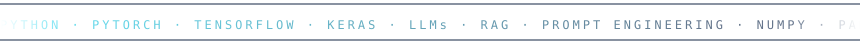
</picture>

</div>

<div align="center">
<picture>
  <source media="(prefers-color-scheme: dark)" srcset="assets/divider.svg" />
  <source media="(prefers-color-scheme: light)" srcset="assets/light/divider.svg" />
  
</picture>
</div>

<!-- ════════════════════ projects ════════════════════ -->

<h2 align="center">▛ PROJECT LOG</h2>

<table>
<tr><td width="50%" valign="top">

<a href="https://ocean-bed.netlify.app/"><picture>
  <source media="(prefers-color-scheme: dark)" srcset="assets/wave-art.svg" />
  <source media="(prefers-color-scheme: light)" srcset="assets/light/wave-art.svg" />
  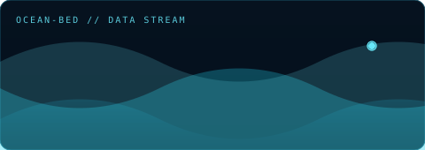
</picture></a>

**⌁ Ocean Bed** — `live`

Ocean-focused **data visualization & prediction** interface. Built to turn
marine/buoy-style data into readable, interactive insights.

`python` `data-viz` `prediction` `netlify`

[](https://ocean-bed.netlify.app/)
[](https://github.com/manbir-2005)

</td><td width="50%" valign="top">

<a href="https://github.com/manbir-2005/Forge-AI-Py-"><picture>
  <source media="(prefers-color-scheme: dark)" srcset="assets/forge-art.svg" />
  <source media="(prefers-color-scheme: light)" srcset="assets/light/forge-art.svg" />
  
</picture></a>

**⌁ Forge AI** — `in development`

AI-powered **python code analysis platform** for intelligent bug detection,
security scanning, code quality assessment, performance optimization, and
AI-assisted code review.

`python` `code-analysis` `static-web-app` `ai-review`

[](https://github.com/manbir-2005/Forge-AI-Py-)

</td></tr>
<tr>
<td valign="top">

`▮ reserved slot — next genai project`

*in development · real link & description will appear here when ready*

</td>
<td valign="top">

`▮ reserved slot — next ml/deep learning project`

*in development · real link & description will appear here when ready*

</td>
</tr>
</table>

<div align="center">
<picture>
  <source media="(prefers-color-scheme: dark)" srcset="assets/divider.svg" />
  <source media="(prefers-color-scheme: light)" srcset="assets/light/divider.svg" />
  
</picture>
</div>

<!-- ════════════════════ role & leadership ════════════════════ -->

<h2 align="center">▛ CURRENT MISSION — UPTOSKILLS</h2>

<div align="center">
<picture>
  <source media="(prefers-color-scheme: dark)" srcset="assets/team-net.svg" />
  <source media="(prefers-color-scheme: light)" srcset="assets/light/team-net.svg" />
  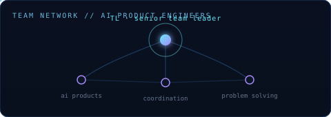
</picture>
</div>

```text
uptoskills :: ai product engineer team
════════════════════════════════════════════

  ◆ role        senior team leader — ai product engineer team
  ◆ focus       ai product development & technical problem-solving
  ◆ day-to-day  coordinating the team · collaboration · shipping
  ◆ outlook     continuous learning — from prototype to product
```

- **Team coordination** — structuring work across the AI Product Engineer team and keeping builds moving together.
- **AI product development** — contributing to practical AI products rather than notebook-only experiments.
- **Technical problem-solving** — breaking ambiguous problems into buildable steps.
- **Continuous learning** — treating the internship as a live lab for production-grade AI skills.

<div align="center">
<picture>
  <source media="(prefers-color-scheme: dark)" srcset="assets/divider.svg" />
  <source media="(prefers-color-scheme: light)" srcset="assets/light/divider.svg" />
  
</picture>
</div>

<!-- ════════════════════ github analytics ════════════════════ -->

<h2 align="center">▛ TELEMETRY — GITHUB ANALYTICS</h2>

<div align="center">

<picture>
  <source media="(prefers-color-scheme: dark)" srcset="assets/telemetry-console.svg" />
  <source media="(prefers-color-scheme: light)" srcset="assets/light/telemetry-console.svg" />
  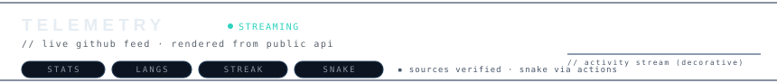
</picture>

<br/>

<table>
<tr>
<td width="52%" align="center">

<picture>
  <source media="(prefers-color-scheme: dark)" srcset="https://github-readme-stats.vercel.app/api?username=manbir-2005&amp;show_icons=true&amp;hide_border=true&amp;bg_color=0,05070d,0a1020&amp;title_color=67e8f9&amp;icon_color=38bdf8&amp;text_color=e6edf3" />
  <source media="(prefers-color-scheme: light)" srcset="https://github-readme-stats.vercel.app/api?username=manbir-2005&amp;show_icons=true&amp;hide_border=true&amp;bg_color=0,f6f8fa,ffffff&amp;title_color=0e7490&amp;icon_color=0891b2&amp;text_color=24292f" />
  
</picture>

</td>
<td width="46%" align="center">

<picture>
  <source media="(prefers-color-scheme: dark)" srcset="https://github-readme-stats.vercel.app/api/top-langs/?username=manbir-2005&amp;layout=compact&amp;hide_border=true&amp;bg_color=0,05070d,0a1020&amp;title_color=67e8f9&amp;text_color=e6edf3&amp;langs_count=8" />
  <source media="(prefers-color-scheme: light)" srcset="https://github-readme-stats.vercel.app/api/top-langs/?username=manbir-2005&amp;layout=compact&amp;hide_border=true&amp;bg_color=0,f6f8fa,ffffff&amp;title_color=0e7490&amp;text_color=24292f&amp;langs_count=8" />
  
</picture>

</td>
</tr>
</table>

<picture>
  <source media="(prefers-color-scheme: dark)" srcset="https://streak-stats.demolab.com?user=manbir-2005&amp;locale=en&amp;hide_border=true&amp;background=05070D&amp;stroke=1E2A45&amp;ring=22D3EE&amp;fire=8B5CF6&amp;currStreakNum=E6EDF3&amp;sideNums=67E8F9&amp;sideLabels=8B949E&amp;dates=64748B&amp;currStreakLabel=67E8F9" />
  <source media="(prefers-color-scheme: light)" srcset="https://streak-stats.demolab.com?user=manbir-2005&amp;locale=en&amp;hide_border=true&amp;background=F6F8FA&amp;stroke=DBE3EE&amp;ring=0891B2&amp;fire=7C3AED&amp;currStreakNum=24292F&amp;sideNums=0E7490&amp;sideLabels=57606A&amp;dates=8B949E&amp;currStreakLabel=0891B2" />
  
</picture>

<!-- Contribution snake — generated daily by .github/workflows/snake.yml into the `output` branch.
     Fallback if the action hasn't run yet: this block simply shows nothing until the first run completes. -->

<sub>▾ contribution snake — real contribution grid · refreshes automatically</sub>

<picture>
  <source media="(prefers-color-scheme: dark)" srcset="https://raw.githubusercontent.com/manbir-2005/manbir-2005/output/github-contribution-grid-snake-dark.svg" />
  <source media="(prefers-color-scheme: light)" srcset="https://raw.githubusercontent.com/manbir-2005/manbir-2005/output/github-contribution-grid-snake-light.svg" />
  
</picture>

<!-- ACTIVITY GRAPH — github-readme-activity-graph.vercel.app returned "Payment Required / DEPLOYMENT_DISABLED"
     on 2026-10-24, so it is intentionally NOT embedded. When the service is online again (or after a self-deploy),
     re-enable with:

-->

<!-- VIEWER COUNTER — optional, external service (komarev). Remove freely.

-->

<br/>

<sub>▪ stat widgets render <b>live</b> from public GitHub data via standard open services ▪ custom SVG artwork is decorative and never poses as data ▪ every visual is <b>theme-aware</b> — switch your appearance (light ⇄ dark) and the whole palette follows</sub>

</div>

<div align="center">
<picture>
  <source media="(prefers-color-scheme: dark)" srcset="assets/divider.svg" />
  <source media="(prefers-color-scheme: light)" srcset="assets/light/divider.svg" />
  
</picture>
</div>

<!-- ════════════════════ currently exploring ════════════════════ -->

<h2 align="center">▛ CURRENTLY EXPLORING</h2>

<div align="center">

```
loading research queue ...
```

| ▸ signal | ▸ focus |
|---|---|
| `neural_networks` | building from scratch — backprop, attention, embeddings |
| `transformers` | internals of the architecture powering modern GenAI |
| `rag_patterns` | retrieval pipelines, chunking, evaluation-first design |
| `agents` | tool-using llm workflows and orchestration |
| `deployment` | packaging models into usable products |

</div>

<div align="center">
<picture>
  <source media="(prefers-color-scheme: dark)" srcset="assets/divider.svg" />
  <source media="(prefers-color-scheme: light)" srcset="assets/light/divider.svg" />
  
</picture>
</div>

<!-- ════════════════════ connect ════════════════════ -->

<h2 align="center">▛ OPEN A CHANNEL</h2>

<div align="center">

<a href="https://github.com/manbir-2005" aria-label="GitHub profile of manbir-2005"></a>
&nbsp;
<a href="https://www.linkedin.com/in/manbir-singh-65b822359/" aria-label="LinkedIn profile of Manbir Singh"></a>
&nbsp;
<a href="https://www.instagram.com/_manna_07/" aria-label="Instagram profile _manna_07"></a>
&nbsp;
<a href="https://www.kaggle.com/manbirr" aria-label="Kaggle profile of Manbir Singh"></a>

<br/><br/>

*`manbir --connect` → response: signal received. open to ai/ml conversations, collaborations and internships.* ✦

</div>

<div align="center">
<picture>
  <source media="(prefers-color-scheme: dark)" srcset="assets/divider.svg" />
  <source media="(prefers-color-scheme: light)" srcset="assets/light/divider.svg" />
  
</picture>
</div>

<!-- ════════════════════ footer ════════════════════ -->

<div align="center">

<picture>
  <source media="(prefers-color-scheme: dark)" srcset="assets/connection-bar.svg" />
  <source media="(prefers-color-scheme: light)" srcset="assets/light/connection-bar.svg" />
  
</picture>

<br/><br/>

<picture>
  <source media="(prefers-color-scheme: dark)" srcset="assets/signature.svg" />
  <source media="(prefers-color-scheme: light)" srcset="assets/light/signature.svg" />
  
</picture>

<br/>

<sub>▚ compiled manually · no template involved ▚</sub>

</div>
